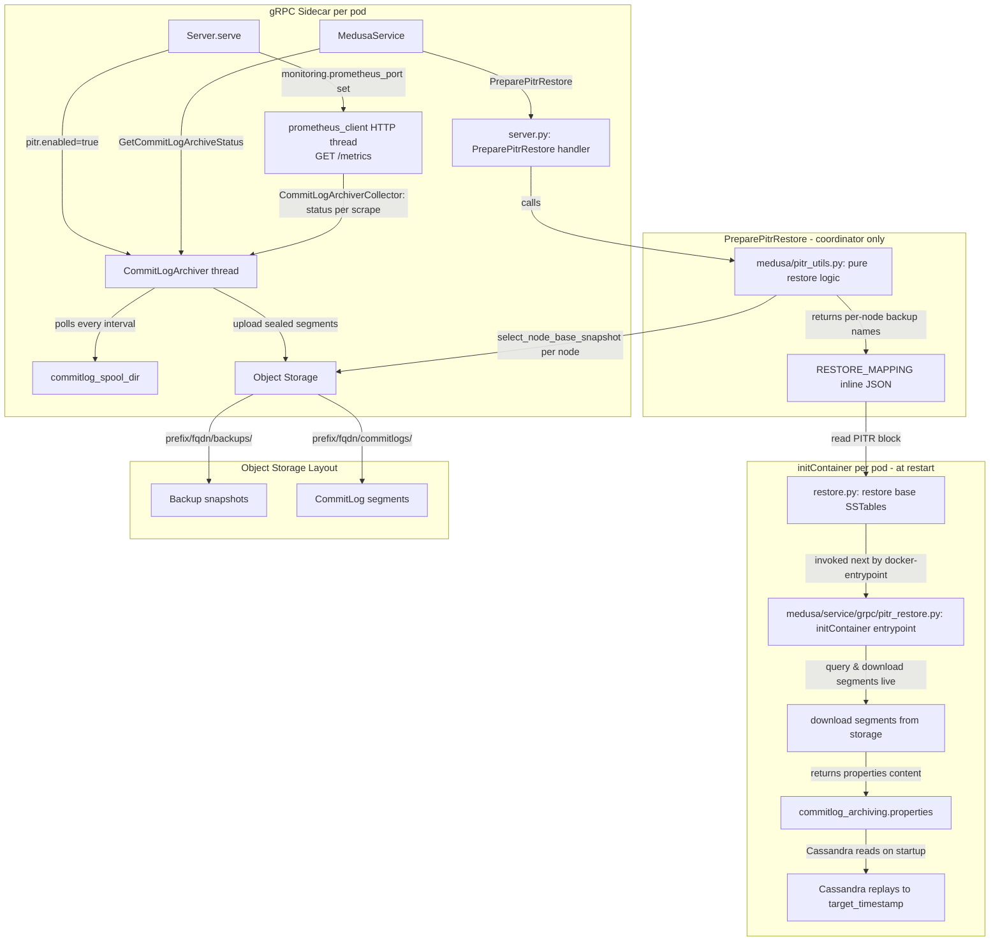
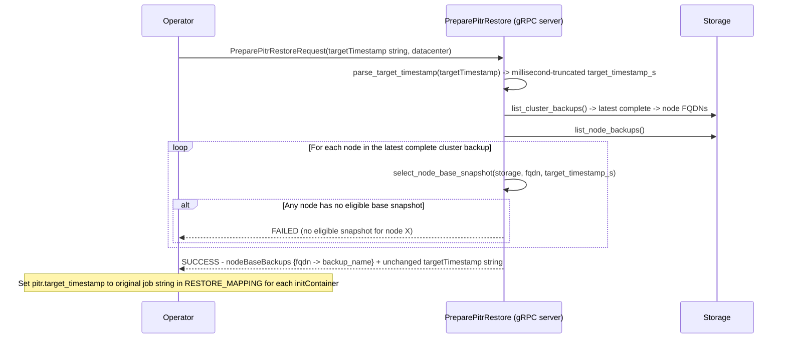

# Point-in-Time Recovery (PITR) for Cassandra Medusa

- **Author(s):** Alexander Dejanovski
- **Status:** Draft
- **Reviewers:** 

---

## 1. Context and Scope

### Background

Cassandra Medusa is a backup and restore tool for Apache Cassandra clusters. It currently supports snapshot-based backups (full and differential) stored in object storage (S3, GCS, Azure, local). Restores can only target an exact backup snapshot, leaving all data written after that snapshot unrecoverable if the cluster is lost or corrupted.

Cassandra itself offers a native mechanism for finer-grained recovery: every mutation is first written to a commitlog segment before being applied. Once a segment is sealed (i.e., the active write position moves to a new segment), it is immutable and can be replayed deterministically. Cassandra exposes a `commitlog_archiving.properties` hook with two commands: `archive_command` fires when a segment is finalized (after the final sync; Cassandra will not delete the segment until the command returns successfully) and can be used to preserve the segment; `restore_command` fires during startup replay to fetch each required segment. Together they allow an external process to archive sealed segments and feed them back during a targeted restore, replaying mutations up to a user-specified timestamp.

### Problem Statement

Operators need to restore a Cassandra cluster to an arbitrary point in time — not just to the moment a snapshot was taken. Typical use cases are:

- **Logical data corruption** (e.g. bad application code writes garbage data at T+5m; the snapshot was taken at T; the operator wants to restore to T+4m).
- **Accidental bulk deletes or truncations** where the exact timestamp of the operation is known.
- **Compliance requirements** mandating a specific recovery point objective (RPO) finer than the snapshot cadence.

### Why Now

The gRPC server mode introduced in Medusa provides a long-lived process context — a prerequisite for running a continuous archiving background thread. With the server model in place, PITR can be added without architectural changes to the core backup/restore pipeline.

### Scope

**In scope:**
- Continuous archiving of sealed Cassandra commitlog segments to object storage. Cassandra's `archive_command` (configured by the operator) creates a hardlink of each finalized segment into a local spool directory; Medusa's `CommitLogArchiver` thread monitors that spool, uploads segments to object storage, and removes the hardlink on completion.
- A new `PreparePitrRestore` gRPC RPC that validates pre-flight conditions and resolves the base snapshot name per-node (ensuring every node has `node_backup.snapshot_time ≤ target_timestamp`), without fetching segment lists centrally.
- Per-node SSTable restore in [`restore.py`](../../../medusa/service/grpc/restore.py): restores the base snapshot SSTables for each node.
- Per-node PITR restore and archiving configuration in [`medusa/service/grpc/pitr_restore.py`](../../../medusa/service/grpc/pitr_restore.py) downloads archived segments to local staging (`/var/lib/cassandra/medusa_commitlog_staging`) and writes `commitlog_archiving.properties` with replay parameters during a PITR restore and `archive_command` when archiving is enabled.
- A new `GetCommitLogArchiveStatus` gRPC RPC for operator health checks.
- Extension of `medusa purge` to delete commitlog segments that no surviving PITR-capable backup can replay (anchored on the oldest surviving PITR-capable backup's `started`, see §4.9).
- A new `[pitr]` configuration section in `medusa.ini`.

**Out of scope (explicit non-goals):**
- `k8ssandra-operator` implementation changes (CRD modifications, controller orchestration, reconciliation loops, and Go client updates are specified and tracked in a dedicated operator design doc; this document defines Medusa's contracts, gRPC APIs, `RESTORE_MAPPING` structure, and runtime behaviour).
- Cross-topology PITR (restoring to a cluster with a different node count).
- DSE-specific commitlog archiving.
- Custom `restore_command` scripts (Medusa always uses the staging-directory pattern).
- Commitlog encryption (segments are subject to the same object-storage encryption-at-rest as backup snapshots; no Medusa-side encryption is added).
- New CLI commands (the existing `medusa-server` gRPC command is the entry point; no new top-level commands are added).

---

## 2. Goals and Non-Goals

### Goals

- **G1:** Enable full-cluster PITR restore to any timestamp covered by archived commitlog segments since the base snapshot.
- **G2:** The archiving daemon runs as a background thread inside the existing gRPC server — no new process, CronJob, or sidecar required.
- **G3:** `pitr.enabled = false` by default; zero behaviour change to backup/restore/purge commands when PITR is disabled. The Prometheus metrics endpoint is opt-in as well: it starts only when `[monitoring] prometheus_port` is set, so an upgrade opens no new listener.
- **G4:** All storage operations use the existing `AbstractStorage` abstraction; no backend-specific code is added.
- **G5:** A failed segment upload never crashes the gRPC server.
- **G6:** Segment finalization is guaranteed by Cassandra's `archive_command` hook before Medusa touches any segment — Medusa never reads from the live commitlog directory.

### Non-Goals

- **NG1:** Cross-topology restore (restoring to a cluster with a different node count — commitlog streams are per-node and cannot be safely split or merged).
- **NG2:** Providing a CLI path for PITR; operator tooling is expected to use the gRPC API.
- **NG3:** Providing segment-level granularity within a single Cassandra write batch.

### Success Criteria

| # | Criterion | How verified |
|---|---|---|
| SC1 | A PITR restore to timestamp T produces a cluster state where all rows written before T are present and all rows written after T are absent | Integration test: row count assertion at a known target timestamp |
| SC2 | `CommitLogArchiver` uploads all segments present in the spool before sleeping until the next tick — a slow batch delays the next tick rather than being interrupted by it | Unit test: `_run_once` with mock storage returning N files; assert all N are uploaded and removed before the sleep call is made |
| SC3 | A failed segment upload does not crash the gRPC server; the segment remains in the spool and is retried on the next tick | Unit test: `_run_once` raises on upload; server continues; segment still present in spool |
| SC4 | `pitr.enabled = false` (default) produces zero behaviour change to existing backup, restore, and purge commands | Run the full existing unit + integration test suite with no `[pitr]` section in `medusa.ini`; assert zero new test failures compared to baseline. Verify that with no `[monitoring] prometheus_port` nothing listens for `/metrics`, and that with it set and PITR disabled `GET /metrics` returns HTTP 200 with only the `prometheus_client` process/platform metrics and no `medusa_commitlog_archiver_*` families. |
| SC5 | `PreparePitrRestore` returns `FAILED` immediately when any node lacks an eligible base backup with `node_backup.snapshot_time ≤ target_timestamp`, aborting before any pod restart or data wipe | Unit test: `select_node_base_snapshot` raises `ValueError`; RPC maps to FAILED response |
| SC6 | `CommitLogArchiver.__init__` raises `RuntimeError` with a clear message when spool dir and commitlog dir are on different devices, or when a path cannot be checked (the message then names the real error), failing fast and crashing Medusa at startup. A commitlog directory that does not exist yet is not an error: the check uses its nearest existing ancestor | Unit test: `os.stat` mocked to return differing `st_dev` (for the commitlog dir, or for the parent of a missing one) or to raise a non-`FileNotFoundError` `OSError`; construction succeeds with the commitlog dir missing |
| SC7 | `purge_commitlogs` deletes all segments whose `blob.last_modified < purge_threshold` and retains all others | Unit test: mock blob list with boundary values |
| SC8 | `GetCommitLogArchiveStatus` returns `running=false` when no archiver is configured; returns correct `pending_count` after N hardlinks are created in the spool | Unit test: (a) RPC invoked with no `CommitLogArchiver` running — assert `running=false`, `pending_count=0`; (b) N dummy segment files written to spool dir before RPC call — assert `pending_count=N` |

---

## 3. Overview (Executive Summary)

PITR is implemented as two cooperating additions to the existing gRPC server:

1. **`CommitLogArchiver` (background thread):** Started on server startup when `pitr.enabled = true`. It polls the local commitlog spool directory (`commitlog_spool_dir`) every `commitlog_archive_interval_seconds` (default: 60s). The spool is populated by Cassandra's `archive_command` (configured by the operator), which creates a hardlink of each finalized segment into that directory immediately after the segment is synced and sealed — guaranteeing Medusa never sees a partially-written file. For each file found, the archiver uploads it to `<prefix>/<fqdn>/commitlogs/` in object storage and removes the hardlink on success.

2. **`PreparePitrRestore` RPC (Pre-flight & Per-Node Base Selection):** Given a string `targetTimestamp`, it parses the value to epoch seconds internally, queries node backups in object storage, and selects an eligible base backup for each node. If any node lacks an eligible base backup before the target timestamp, the RPC returns `FAILED` immediately, preventing destructive data wipes on a cluster that cannot be fully restored. If all nodes are eligible, it returns a map of `{fqdn: backup_name}` and the original request string in `targetTimestamp`, unchanged. It does not query or list commitlog segments centrally. The operator assembles a single `RESTORE_MAPPING` JSON — containing `pitr.target_timestamp` as the original job timestamp string and the full `node_backups` map — and sets it identically on every pod's initContainer. Each pod resolves its own `backup_name` at runtime by looking up its `fqdn` in `pitr.node_backups`. **`node_backup.snapshot_time != None` is the storage-readable signal that a backup is PITR-capable** — the operator uses this to gate PITR restores without needing access to `k8ssandraCluster.spec.medusa.pitr.enabled` (which lives in the control plane and is unavailable to data-plane DCs and out-of-place disaster restores). Backups created while `pitr.enabled = false` have no `snapshot_time` blob and are not PITR-capable.

3. **Per-node `medusa.service.grpc.pitr_restore` entrypoint:** After the SSTable step succeeds or is skipped, the initContainer runs [`medusa/service/grpc/pitr_restore.py`](../../../medusa/service/grpc/pitr_restore.py). For a pending PITR restore, it resets staging, downloads segments archived since `base_backup.started` (see §4.5), and writes replay parameters. It includes `archive_command` when local archiving is enabled. Cassandra replays segments up to `restore_point_in_time` on startup and skips mutations already persisted in the base SSTables. No SSH is used at any point.

The design is purely additive. Existing backup, restore, and purge commands are unchanged when PITR is disabled.

---

## 4. Proposed Architecture & Detailed Design

### 4.1 System Architecture



### 4.2 Complete File Map

| File | Change | Responsibility |
|---|---|---|
| [`medusa/config.py`](../../../medusa/config.py) | Modify | `PitrConfig` namedtuple; `[pitr]` section defaults; `MedusaConfig.pitr` field; adds `prometheus_port`, `prometheus_address`, `prometheus_tls_cert`, `prometheus_tls_key` and `prometheus_ca_cert` to `MonitoringConfig`; `is_pitr_enabled(config)` helper — the single place that answers whether PITR is on, used by `backup_node.py` and `purge.py` |
| [`medusa/service/grpc/commitlog_archiver.py`](../../../medusa/service/grpc/commitlog_archiver.py) | Create | `CommitLogArchiver` background thread; `drain_spool()` helper; records tick counters, progress/success timestamps and the oldest pending segment age, all returned by `status()`; knows nothing about metrics |
| [`medusa/service/grpc/server.py`](../../../medusa/service/grpc/server.py) | Modify | Archiver lifecycle; `GetCommitLogArchiveStatus` + `PreparePitrRestore` RPC handlers; starts the Prometheus `/metrics` endpoint when `[monitoring] prometheus_port` is set (bind or TLS failure is fatal); stops it in `shutdown()`, when `serve()` ends, and when gRPC startup fails |
| [`medusa/service/grpc/restore.py`](../../../medusa/service/grpc/restore.py) | Modify | Update `restore_backup(..., backup_name=...)` signature to support per-node base backup override |
| [`medusa/service/grpc/pitr_restore.py`](../../../medusa/service/grpc/pitr_restore.py) | Create | Per-node PITR & archiving restore entrypoint: clean staging, check guard, download segments, manage `commitlog_archiving.properties` |
| [`medusa/service/grpc/medusa.proto`](../../../medusa/service/grpc/medusa.proto) | Modify | Add `GetCommitLogArchiveStatus` + `PreparePitrRestore` RPCs and message types (purely additive — no existing RPCs removed) |
| [`medusa/pitr_utils.py`](../../../medusa/pitr_utils.py) | Create | Pure restore logic: `select_node_base_snapshot`, `find_next_backup`, `find_commitlog_segments`, `download_commitlog_segments`, `generate_commitlog_archiving_properties` |
| [`k8s/docker-entrypoint.sh`](../../../k8s/docker-entrypoint.sh) | Modify | Always invoke `medusa.service.grpc.pitr_restore` after SSTable restore step |
| [`medusa/storage/node_backup.py`](../../../medusa/storage/node_backup.py) | Modify | Add `snapshot_time` property. Value comes from the `snapshot_time_*` index blob: preloaded by `list_node_backups()`, or looked up lazily with one `list_objects` call on `index/backup_index/<name>/snapshot_time_<fqdn>_` when the `NodeBackup` was built by `get_node_backup()`. Returns `None` when absent. **`snapshot_time is not None` is the storage-readable PITR-capability flag**: the operator reads this directly from object storage metadata to determine whether a backup can be PITR-restored, without requiring control-plane access. |
| [`medusa/storage/cluster_backup.py`](../../../medusa/storage/cluster_backup.py) | Modify | Add `min_snapshot_time` and `max_snapshot_time` properties aggregating `node_backup.snapshot_time` across nodes |
| [`medusa/cassandra_utils.py`](../../../medusa/cassandra_utils.py) | Modify | Return the **latest** mtime across the snapshot directories of the node before snapshot cleanup, to record the node snapshot timestamp (int epoch seconds); `snapshot_time` is `None` / missing when no snapshot directories are present — no fallback to `started` |
| [`medusa/index.py`](../../../medusa/index.py) | Modify | Persist `snapshot_time_{fqdn}_{timestamp}.timestamp` index blob; written only when `pitr.enabled = true` |
| [`medusa/storage/__init__.py`](../../../medusa/storage/__init__.py) | Modify | Read `snapshot_time` index blob in `list_node_backups()` to populate `NodeBackup` |
| [`medusa/purge.py`](../../../medusa/purge.py) | Modify | `oldest_kept_pitr_backup_start()` (retention anchor); `purge_commitlogs()` (concurrent deletes via `delete_objects`, returns the deleted count); PITR hook in `main()` gated by `config.is_pitr_enabled` |
| [`medusa-example.ini`](../../../medusa-example.ini) | Modify | Document `[pitr]` config section; document the `prometheus_*` settings under `[monitoring]` |
| [`docs/Configuration.md`](../../../docs/Configuration.md) | Modify | Document the `prometheus_*` settings under `[monitoring]` |
| [`medusa/service/grpc/metrics.py`](../../../medusa/service/grpc/metrics.py) | Create | `CommitLogArchiverCollector` (pull collector over `CommitLogArchiver.status()`), per-server registry, `/metrics` HTTP(S) endpoint serving `prometheus_client`'s WSGI app |
| [`pyproject.toml`](../../../pyproject.toml) | Modify | `prometheus-client` (pinned) in the `grpc` and `grpc-runtime` dependency groups; only the gRPC server imports it |

### 4.3 Configuration

A new `[pitr]` section is added to [`medusa/config.py`](../../../medusa/config.py) as a `PitrConfig` namedtuple, parallel to the existing `KubernetesConfig`:

```python
PitrConfig = collections.namedtuple(
    'PitrConfig',
    ['enabled', 'commitlog_archive_interval_seconds', 'commitlog_spool_dir', 'commitlog_staging_dir',
     'commitlog_restore_grace_period_seconds']
)
```

Defaults in `_build_default_config()`:

```ini
[pitr]
enabled = false
commitlog_archive_interval_seconds = 60
commitlog_spool_dir = /var/lib/cassandra/commitlog_spool_dir
commitlog_staging_dir = /var/lib/cassandra/medusa_commitlog_staging
commitlog_restore_grace_period_seconds = 3600
```

`commitlog_spool_dir` must be on the same filesystem (volume) as Cassandra's commitlog directory (`/var/lib/cassandra/commitlog`) — hardlinks cannot cross filesystem boundaries. Defaulting to `/var/lib/cassandra/commitlog_spool_dir` ensures it resides on the persistent Cassandra data mount. In Kubernetes, this is shared between the Cassandra container and the Medusa sidecar.

`commitlog_staging_dir` specifies the local staging directory (default: `/var/lib/cassandra/medusa_commitlog_staging`) where the `medusa.service.grpc.pitr_restore` entrypoint downloads commitlog segments from object storage during a PITR restore. Residing directly on the Cassandra persistent data volume, it leverages the volume's high capacity. The entrypoint resets staging when archiving is enabled or a PITR restore is pending.

`commitlog_restore_grace_period_seconds` (default: `3600`, i.e. 1 hour) sets the upper-bound grace period applied when selecting commit log segments during a restore. At restore time, the `medusa.service.grpc.pitr_restore` entrypoint calls `find_next_backup(storage, fqdn, base_backup)` (from `medusa/pitr_utils.py`) to locate the earliest backup whose `snapshot_time > base_backup.snapshot_time`. When found, the upper bound for segment fetch is `next_backup.snapshot_time + commitlog_restore_grace_period_seconds`. This handles async upload lag: segments belonging to the restore window may still be in flight when the next backup snapshot starts, so a conservative window beyond the next snapshot time ensures they are captured. When there is no subsequent backup, `upper_bound_s` falls back to `time.time()` (the current wall clock) — avoiding an unbounded scan while still capturing any segments that have been uploaded since the base snapshot.

`archive_command` is not a config field — it is derived at runtime from `commitlog_spool_dir`:

```python
archive_command = f"/bin/ln %path {config.pitr.commitlog_spool_dir}/%name"
```

This ensures the generated `commitlog_archiving.properties` is always consistent with the configured spool directory without requiring a separate, potentially conflicting config value.

`[checks].enable_md5_checks` is reused from the existing `[checks]` section for upload deduplication.

#### `[monitoring]` — Prometheus endpoint

`prometheus_port` and `prometheus_address` are added to `MonitoringConfig` in [`medusa/config.py`](../../../medusa/config.py):

```ini
[monitoring]
; unset (default): no /metrics endpoint
prometheus_port = 9500
; default 0.0.0.0
prometheus_address = 0.0.0.0
; optional: HTTPS when both are set
prometheus_tls_cert = metrics_server.crt
prometheus_tls_key = metrics_server.key
; optional: require client certificates signed by this CA (mutual TLS)
prometheus_ca_cert = metrics_ca.pem
```

The endpoint is opt-in (G3): nothing listens unless `prometheus_port` is set. There is no default port because the usual exporter ports are taken on Cassandra hosts, and collide when k8ssandra runs with `hostNetwork`: 9100 (node_exporter), 9000 (management-api metrics), 9103 (MCAC). When the port is set but cannot be bound, the gRPC server fails at startup, the same way a bad spool mount does, so an operator who asked for metrics never silently runs without them. The endpoint runs whether or not PITR is enabled. Operators scrape `http(s)://<pod-ip>:<prometheus_port>/metrics` (Vector.dev in k8ssandra deployments).

TLS is optional. With `prometheus_tls_cert` and `prometheus_tls_key` (PEM) the endpoint serves HTTPS only, with TLS 1.2 as the minimum version. Adding `prometheus_ca_cert` turns on mutual TLS: scrapers must present a client certificate signed by that CA. The keys are separate from the `[grpc]` TLS settings, so each endpoint can be secured on its own. An incomplete combination (only one of cert/key, or a CA without them) or a file that cannot be loaded fails startup, like a bind failure; the files are loaded before the port is bound.

### 4.4 CommitLogArchiver

`CommitLogArchiver` is a `threading.Thread` subclass (daemon thread) started from [`Server.serve()`](../../../medusa/service/grpc/server.py:66) when PITR is enabled, and stopped in `Server.shutdown()`. Starting it in `serve()` (rather than `__init__`) avoids thread leaks in unit test suites where `Server` is instantiated without being run.

**Startup validation:**

`CommitLogArchiver.__init__` checks that `commitlog_spool_dir` and the Cassandra commitlog directory reside on the same filesystem. It stats the Cassandra commitlog directory first, then creates the spool directory if it does not exist, then stats the spool directory, and compares the two `st_dev` values. If the devices differ, it raises `RuntimeError` immediately with a message of the form:

```
commitlog_spool_dir '<path>' is on a different device than the Cassandra commitlog
directory '<path>'. Hardlinks cannot cross filesystem boundaries. Mount both paths
on the same volume.
```

A missing Cassandra commitlog directory is not an error. Cassandra creates it in `DatabaseDescriptor.createAllDirectories()` when the daemon starts, and under cass-operator that waits for the operator's `/api/v0/lifecycle/start` call, so on a fresh volume the sidecar always starts first. The check then stats the nearest existing ancestor of the commitlog directory instead: the directory will be created on that ancestor's device, so the result is the same. Medusa never creates the commitlog directory itself; Cassandra owns it.

Any other `OSError` (permission denied, for example) also raises `RuntimeError`, with a message that names the real error rather than the device-mismatch text.

The `medusa-restore` init container (`medusa.service.grpc.pitr_restore`) creates the spool directory before it writes `commitlog_archiving.properties`, so Cassandra's `archive_command` can link into it from the first segment, even while the sidecar is not up yet.

Because `CommitLogArchiver` is initialized in [`Server.serve()`](../../../medusa/service/grpc/server.py:66) when `pitr.enabled = true`, this exception is intentionally unhandled at startup: it **fails fast and crashes Medusa immediately** (causing the sidecar container/process to exit with a non-zero code). This guarantees that filesystem misconfigurations cannot go unnoticed or run in a silently degraded state where Cassandra's `archive_command` would later fail with `EXDEV`. `Server.serve()` does not catch `RuntimeError`; the exception propagates uncaught out of `serve()` to the process entry point, which exits with a non-zero code — this is the intended crash-fast behaviour.

**Spool drain (`drain_spool`):**

Medusa never reads from Cassandra's live commitlog directory. Instead, the operator configures Cassandra with:

```
archive_command=/bin/ln %path <commitlog_spool_dir>/%name
```

Cassandra executes this command after the segment's final fsync and before it is eligible for deletion — the hardlink is therefore always a complete, immutable snapshot of the finalized file. Because hardlinks share the same inode, creation is atomic and requires no data copy; they do require the spool directory and the commitlog directory to be on the same filesystem (same volume).

`drain_spool` lists all files in `commitlog_spool_dir`, and for each:
1. Checks `<prefix>/<fqdn>/commitlogs/<filename>` in storage.
   - If absent → upload.
   - If present and size matches → skip (already uploaded); or MD5 check if `[checks].enable_md5_checks=true`.
   - If present but size mismatches → re-upload (partial upload from a prior crash).
2. On successful upload or confirmed-present skip: removes the hardlink from the spool.
3. On upload failure: logs the error, leaves the hardlink in place for retry next tick.

**Upload loop (`_run_once`):**

`_run_once` is invoked from a single daemon thread only — there are no concurrent invocations. The internal lock guards only the status counters read by `status()`.

1. Call `drain_spool()`, which handles the full per-file cycle: check storage, upload or skip, remove hardlink on success, log on failure.
2. Update internal status counters under a lock.
3. Any exception from `drain_spool()` is caught and logged; the thread continues.

**Lifecycle:**
- `start()` — begins the polling loop (inherited from `Thread`).
- `stop()` — sets a `threading.Event`; joins with `timeout=interval+5s`.
- `status() → dict` — returns `running`, `last_upload_time`, `pending_count`, `interval_seconds`, `status` (`StatusType`: `IN_PROGRESS` while the archiver thread is alive, `FAILED` if stopped unexpectedly), `last_error` (the error of the last tick, empty once a tick archives everything it listed), the instrumentation state below, and `spool_listing_error`. `pending_count` and `oldest_pending_age_seconds` are computed by listing `commitlog_spool_dir` on every call. If the listing fails, the last known values are kept and the failure is returned in `spool_listing_error`. `status()` never writes `last_error`: only ticks own it, so a scrape cannot replace a tick's real error (e.g. a storage 403) with a listing error, or report an error for a healthy archiver until the next tick.

**Metrics instrumentation:**

The archiver does not know about metrics. It keeps the following state under its `_lock`, updated by the tick (`_run_once` / `drain_spool`), and returns it from `status()`; the metrics collector (§4.12) reads it on each scrape.

| Field | Meaning |
|---|---|
| `ticks_success`, `ticks_error` | Tick outcomes. A tick is an error if `drain_spool()` raised (spool unreadable, storage cannot be opened) or returned a non-empty `error`. A tick cut short by `stop()` counts as neither. |
| `segments_uploaded`, `segments_skipped`, `uploaded_bytes` | Cumulative, from each tick's `DrainResult`. |
| `last_progress_time` | Set at tick start and after each segment is archived, so a long backlog drain does not look stalled. Stops advancing if the thread dies or hangs inside an upload. |
| `last_success_time` | End of the last tick that archived everything it listed. |
| `oldest_pending_age_seconds` | Age (now − mtime) of the oldest file in the spool, computed in `status()`; `0` when the spool is empty. |

Timestamps are `0` until first set. `drain_spool()` stops at the first failing segment, so there is no per-segment error counter: the error signal is `ticks_error`.

### 4.5 medusa/pitr_utils.py — Pure Restore Logic

[`medusa/pitr_utils.py`](../../../medusa/pitr_utils.py) contains only decision logic with no gRPC or SSH dependencies, making it independently testable.

| Function | Signature | Description |
|---|---|---|
| `select_node_base_snapshot` | `(storage, fqdn: str, target_timestamp_s: float) -> NodeBackup` | Most recent node backup for `fqdn` with `snapshot_time ≤ target_timestamp_s`; raises `ValueError` if none. Backups whose `snapshot_time` is `None` (no `snapshot_time` index blob — pre-PITR backups without archived commitlogs) are ineligible and skipped entirely. |
| `find_next_backup` | `(storage, fqdn: str, base_backup: NodeBackup) -> NodeBackup \| None` | Returns the earliest node backup for `fqdn` whose `snapshot_time > base_backup.snapshot_time`, or `None` if no such backup exists. Used by `medusa.service.grpc.pitr_restore` to compute `upper_bound_s` for segment selection. |
| `find_commitlog_segments` | `(storage: Storage, prefix_path: str, fqdn: str, after_snapshot_time_s: float, upper_bound_s: float, safety_margin_s: float = 30.0) -> List[AbstractBlob]` | All storage blobs for this node with `blob.last_modified ≥ (after_snapshot_time_s - safety_margin_s)` and `blob.last_modified ≤ upper_bound_s`; sorted ascending by filename. `after_snapshot_time_s` (lower bound; callers pass `base_backup.started`). `upper_bound_s` is required — callers must always pass a computed value (either `next_backup.snapshot_time + grace_period` or `time.time()`). |
| `download_commitlog_segments` | `(storage: Storage, segments: List[AbstractBlob], destination_dir: Path \| str) -> None` | Downloads the list of commitlog segment blobs from object storage into `destination_dir`. Overwrites existing files with the same name. |
| `parse_target_timestamp` | `(raw: str) -> float` | Shared timestamp parser for RPC preparation and initContainer replay. Converts the string to UTC epoch seconds, truncating downward to milliseconds before float conversion in both paths. |
| `get_pitr_target_timestamp_s` | `(pitr_mapping: dict) -> float` | Parses the `target_timestamp` string from the operator's `pitr` block into epoch seconds, truncating to milliseconds. Missing or invalid values raise `ValueError`; numeric mapping values are not accepted. |
| `generate_commitlog_archiving_properties` | `(archive_command: str \| None, restore_directories: str \| None = None, target_timestamp_s: float \| None = None) -> str` | Renders `archive_command` when supplied. With a nonempty `restore_directories` and a target timestamp, it renders `restore_directories`, `restore_command`, and `restore_point_in_time` (formatted as `yyyy:MM:dd HH:mm:ss.SSS` in UTC). |

**Timestamp Parsing and Formatting:**
- The operator accepts RFC3339 timestamps with a timezone (for example `2024-07-15T12:30:00.500Z`) or Unix epoch seconds as a decimal string (for example `1721046600.5`). Both gRPC `targetTimestamp` fields and `RESTORE_MAPPING.pitr.target_timestamp` carry strings.
- `PreparePitrRestore` calls the shared `parse_target_timestamp()` to obtain a millisecond-truncated UTC epoch float (`target_timestamp_s`) for base-backup selection. Its response preserves the original request string unchanged. The operator uses the original job string when constructing the restore mapping.
- The initContainer calls `get_pitr_target_timestamp_s(mapping["pitr"])`, which delegates to the same `parse_target_timestamp()` for the millisecond-truncated replay cutoff. `target_timestamp_s` is an internal variable and helper parameter, not a JSON or protobuf field.
- Medusa's shared parser also accepts timezone-free ISO-8601 datetimes and interprets them as UTC; the operator requires a timezone for RFC3339 input.
- `generate_commitlog_archiving_properties` formats the replay cutoff as `yyyy:MM:dd HH:mm:ss.SSS` in UTC, truncating finer precision to milliseconds. For example, either `2024-07-15T12:30:00.500Z` or `1721046600.5` produces `restore_point_in_time=2024:07:15 12:30:00.500`.

Segment filenames are used only for ordering and as storage object keys — their embedded ID is not used for time filtering.

**Why the latest mtime.** Snapshot directories are created table by table. The base SSTables hold data up to the *latest* directory mtime, so `select_node_base_snapshot` must compare that value to the target. For the **segment lower bound** the earliest flushed table matters: mutations written after that table was flushed are not in its SSTables. `started` is always earlier than every snapshot directory, so `pitr_restore` passes `base_backup.started` (not `snapshot_time`) as `after_snapshot_time_s`. Replaying extra older segments is safe: Cassandra skips mutations already persisted in SSTables.

**Pre-PITR backups without `snapshot_time` cannot serve as base snapshots for PITR restore.** A backup lacking a `snapshot_time` index blob predates commitlog archiving: no commitlog segments were archived during or after that backup, so replaying from it to an arbitrary target timestamp is not possible. More critically, if `started` were used as a proxy, the `started ≤ target_timestamp_s` check could pass even when the actual snapshot completed *after* `target_timestamp_s` — meaning the base SSTables already contain mutations past the target time, producing a silent data-past-target-time violation. For this reason, `select_node_base_snapshot` rejects any backup with `snapshot_time is None` rather than falling back to `started`. Backups created while `pitr.enabled = false` have no `snapshot_time` blob and are not PITR-capable.

### 4.6 Kubernetes Restore Model — Why SSH Orchestration Does Not Apply

Understanding the existing Kubernetes restore flow is essential before designing the PITR restore path.

In Kubernetes, Medusa runs as **two containers in every Cassandra pod**:

- **Sidecar container** (`MEDUSA_MODE=GRPC`): runs the gRPC server (including `CommitLogArchiver`). It has direct access to the local filesystem and the local Cassandra commitlog directory.
- **initContainer** (`MEDUSA_MODE=RESTORE`): runs [`medusa/service/grpc/restore.py`](../../../medusa/service/grpc/restore.py) once at pod startup. It calls [`restore_node.restore_node()`](../../../medusa/restore_node.py) which downloads SSTables, places data, and returns — **without starting Cassandra**. The StatefulSet or Cassandra operator manages pod lifecycle and starts Cassandra.

In the Kubernetes path, the `MedusaRestoreJob` controller calls `GetHostMap` (an operator-internal Go function in [`k8ssandra-operator/pkg/medusa/hostmap.go`](../../../k8ssandra-operator/pkg/medusa/hostmap.go) that lists the backup's nodes and derives a source→target mapping locally in the operator), stores the result in `MedusaRestoreJob.Status.RestoreMapping`, marshals it to inline JSON, and injects it as the `RESTORE_MAPPING` env var on the `medusa-restore` initContainer in the `CassandraDatacenter` `PodTemplateSpec`. A rolling restart propagates this to every pod; the initContainer reads its own entry from the env var at startup. No file is written to disk.

There is **no SSH orchestration in the Kubernetes path**. Each node restores itself locally. The `Orchestration`/SSH layer in `medusa/orchestration.py` is the non-Kubernetes path and must not be used here.

### 4.7 PreparePitrRestore — Coordinator RPC

The PITR coordinator follows the same pattern as `MedusaRestoreJob` in the k8ssandra-operator: the gRPC server performs pre-flight storage validation and returns the result to the caller; the operator assembles the full `RESTORE_MAPPING` JSON and injects it directly into the initContainer env var. No file is written to disk by the RPC.

**Why per-node base backup resolution:** Because node snapshots complete at slightly different times across the cluster, a single global backup selection can be inaccurate. Evaluating `select_node_base_snapshot` per node ensures each node restores from a base snapshot whose snapshot time is strictly prior to `target_timestamp`. Furthermore, evaluating this pre-flight across all nodes guarantees that if even a single node lacks a valid base snapshot, the restore fails fast before any pods are restarted or data is wiped.

**Metadata delivery:** `PreparePitrRestore` is called against any live Medusa gRPC sidecar (the operator chooses which pod to target — no election needed). The RPC derives the node set from the most recent **complete** cluster backup (`storage.list_cluster_backups()`, `is_complete()`, newest `started`): the keys of its `node_backups`. A node absent from that backup, or a cluster with no complete backup, returns `FAILED`. Nodes that appear only in older backups (decommissioned) are ignored. The RPC resolves the base backup for each node and returns a mapping of `{fqdn: backup_name}` and the original request string in `targetTimestamp`. No commitlog segments are listed or returned by the RPC, keeping the coordinator call fast and scalable.

The operator then:
1. Calls `GetHostMap` (an operator-internal Go function in [`k8ssandra-operator/pkg/medusa/hostmap.go`](../../../k8ssandra-operator/pkg/medusa/hostmap.go) — not a Medusa gRPC RPC) to compute `in_place` / `host_map` from the Kubernetes StatefulSet topology and the backup node list.
2. Assembles a single `RESTORE_MAPPING` JSON containing a `pitr` block with `target_timestamp` set to the original `MedusaRestoreJob.spec.targetTimestamp` string and a `node_backups` map of `{fqdn: backup_name}` for every node in the cluster. The operator does not use the response timestamp to construct the mapping.
3. Sets the same `RESTORE_MAPPING=<inline-JSON>` on **every** pod's initContainer before restarting them.

Each pod's `restore.py` reads `RESTORE_MAPPING` via `json.loads()` (the same inline-JSON parsing path used today; the `pitr` block is a new optional key handled by the modified `restore_backup()` described in §4.8). This RPC is idempotent and safe to retry: all operations are read-only against object storage.

**RPC Sequence:**



The `RESTORE_MAPPING` JSON is identical on every pod's initContainer. Each pod resolves its own entry using its local `fqdn`:
```json
{
  "in_place": true,
  "host_map": {
    "node1.fqdn": {"source": ["node1.fqdn"], "seed": false},
    "node2.fqdn": {"source": ["node2.fqdn"], "seed": false},
    "node3.fqdn": {"source": ["node3.fqdn"], "seed": false}
  },
  "pitr": {
    "target_timestamp": "1721000000.0",
    "node_backups": {
      "node1.fqdn": "backup-20240715-node1",
      "node2.fqdn": "backup-20240715-node2",
      "node3.fqdn": "backup-20240715-node3"
    }
  }
}
```

The `pitr` block contains the full cluster mapping. `target_timestamp` is a string; the example uses epoch seconds, and an RFC3339 value such as `"2024-07-15T12:30:00.500Z"` is also valid. Each initContainer reads its own `fqdn` (from the pod's hostname or the Medusa config) and looks up `pitr.node_backups[fqdn]` to obtain its assigned `backup_name`.

### 4.8 Per-Node PITR Restore & Archiving Configuration

After `PreparePitrRestore` succeeds, the operator restarts the pods. In Kubernetes (`MEDUSA_MODE=RESTORE`), [`k8s/docker-entrypoint.sh`](../../../k8s/docker-entrypoint.sh) validates the restore request before orchestrating two sequential steps during initContainer startup. The PITR step's entrypoint is `medusa.service.grpc.pitr_restore` ([`medusa/service/grpc/pitr_restore.py`](../../../medusa/service/grpc/pitr_restore.py)), which imports the pure logic from `medusa/pitr_utils.py` (§4.5):

```
docker-entrypoint.sh (MEDUSA_MODE=RESTORE)
  |-- 0. Preflight validation (before changing Cassandra data)
  |     |-- parse and validate RESTORE_MAPPING
  |     |-- restore requested: nonempty RESTORE_KEY, BACKUP_NAME or PITR mapping, pod participates
  |     |-- restore needed: restore requested AND .last-restore differs from RESTORE_KEY (or file absent)
  |     +-- if a PITR restore is needed: validate target_timestamp
  |
  |-- 1. SSTable restore step (restore.py)
  |     |-- if restore needed: run restore.py
  |     +-- otherwise: skip SSTable restore
  |
  |-- 2. PITR & Archiving properties step (medusa.service.grpc.pitr_restore) [AFTER STEP 1 SUCCEEDS OR SKIPS]
  |     |-- read .last-restore and determine whether this pod has a pending PITR restore
  |     |-- return successfully if archiving is off and no PITR restore is pending
  |     |-- for a pending PITR restore, validate the cutoff and resolve the source node and base backup
  |     |-- reset the staging directory (/var/lib/cassandra/medusa_commitlog_staging)
  |     |-- for a pending PITR restore, download source segments and include replay settings
  |     |-- include archive_command when local archiving is enabled
  |     +-- write commitlog_archiving.properties
  |
  +-- 3. write RESTORE_KEY > .last-restore only if a restore was needed and steps 1 and 2 succeeded
```

**`RESTORE_MAPPING` format:** `RESTORE_MAPPING` is always inline JSON — the same `json.loads()` path used today. The `pitr` block is an optional top-level key in that JSON, present only for PITR restores. A regular (non-PITR) restore has no `pitr` key and the existing SSTable restore path is completely unchanged.

**Changes to `apply_mapping_env()` in `restore.py`:** `apply_mapping_env()` is modified to also return the full parsed `mapping` dict alongside `in_place`, so the caller (`__main__`) can pass the `pitr` block downstream. The return type changes from `bool | None` to `tuple[bool, dict] | None` — `(in_place, mapping)`. Existing callers that only consume `in_place` are updated accordingly. The `host_map` lookup logic is unchanged.

**`restore_backup()` signature change in `restore.py`:** `restore_backup(in_place, config)` gains a new `backup_name=None` parameter and a `mapping=None` parameter carrying the full parsed `RESTORE_MAPPING`. When `backup_name` is `None` and `mapping` contains a `pitr` block, `restore_backup()` resolves the local pod's source FQDN using the same `host_map`-aware logic as `medusa.service.grpc.pitr_restore`: if `POD_NAME` is set and appears in `mapping["host_map"]`, it returns `mapping["host_map"][POD_NAME]["source"][0]`; otherwise it falls back to `POD_IP` or `config.storage.fqdn`. It then looks up `mapping["pitr"]["node_backups"][fqdn]` to obtain its assigned `backup_name`. When `backup_name` is `None` and there is no `pitr` block, it falls back to `os.environ["BACKUP_NAME"]` — preserving full backward compatibility for non-PITR restores.

`restore_backup()` calls `restore_node_locally()`, which wipes the commitlog directory via `clean_path(cassandra.commit_logs_path, ...)`. Because `medusa.service.grpc.pitr_restore` runs **after** `restore.py` completes, segment downloading and properties generation happen on a clean slate.

`restore_node_locally()` also wipes the hints directory (`hints_directory` in `cassandra.yaml`, default `/var/lib/cassandra/hints`) via `clean_path(cassandra.hints_path, ...)`, right after the commitlog cleanup. When the DC is stopped for a restore, nodes that are still up store hints for the writes their stopped peers miss. A hint is a regular mutation carrying its original write timestamp, and Cassandra does not apply `restore_point_in_time` to it. If hints survive the restore, they are delivered once the nodes start and re-apply writes made after the target time (read repair then spreads them to the other replicas). Every node runs the restore init container, so all hints from all peers are removed before any node starts. This applies to every restore that goes through `restore_node_locally()`, PITR or not.

**`commitlog_archiving.properties` ownership & lifecycle:** [`medusa/service/grpc/pitr_restore.py`](../../../medusa/service/grpc/pitr_restore.py) is always invoked by `docker-entrypoint.sh` to generate and maintain `commitlog_archiving.properties` in `Path(cassandra_config.config_file).parent` (the directory containing `cassandra.yaml`).
- When `pitr.enabled` is `true`, archiving configuration is always maintained in `commitlog_archiving.properties` so Cassandra can continuously archive commitlogs once running.
- A pending PITR restore (a `pitr` block, a nonempty `RESTORE_KEY`, a participating pod, and a missing or different `.last-restore` key) writes replay settings even when `pitr.enabled = false` or the `[pitr]` section is absent. An out-of-place target replays its mapped source node's segments from the shared storage prefix.
- With archiving enabled and no pending PITR restore, the entrypoint writes only `archive_command`.
- With archiving disabled or unset and no pending PITR restore, the entrypoint returns successfully and leaves staging and any existing properties file untouched.
- The config directory is a shared volume mounted across initContainers and the Cassandra container, so Medusa can write there directly.

During a PITR restore with archiving disabled or unset, the generated properties contain the replay settings.

```properties
restore_directories=/var/lib/cassandra/medusa_commitlog_staging
restore_command=/bin/mv -f %from %to
restore_point_in_time=2024:07:15 12:30:00.500
```

**Why `mv` for `restore_command`:** Cassandra runs `restore_command` once per file in `restore_directories`, substituting the staged file for `%from` and `<commitlog directory>/<segment name>` for `%to`, and skips files whose `%to` already exists (`CommitLogArchiver.maybeRestoreArchive`). The staged segments are throwaway downloads from object storage, so moving them is enough; Cassandra's documented example, `cp -f`, would keep a second copy of every segment on the data volume for the whole replay (segment volumes: §6.1). `ln` is not used here, unlike for `archive_command`: it would add a second same-device constraint, between `commitlog_staging_dir` and the commitlog directory, that no startup check enforces (§4.4 checks only the spool directory), and it would still leave two names for every segment.

When local archiving is enabled, Medusa adds the following command during a restore and writes it on its own during normal startup.

```properties
archive_command=/bin/ln %path /var/lib/cassandra/commitlog_spool_dir/%name
```

Cassandra startup detects `commitlog_archiving.properties` and replays segments up to `restore_point_in_time` automatically. No Medusa code starts or stops Cassandra.

**Entrypoint Flow in `docker-entrypoint.sh`:**

```bash
# The entrypoint enables set -e before calling restore().
restore() {
    echo "Running Medusa in restore mode"
    local last_restore_file="/var/lib/cassandra/.last-restore"
    local config_file=/etc/medusa/medusa.ini
    local restore_key="${RESTORE_KEY:-}"
    local restore_needed

    # Reject invalid mappings and cutoffs before changing Cassandra data.
    restore_needed=$(poetry run python -c '
import os
import sys

from medusa.pitr_utils import get_pitr_target_timestamp_s
from medusa.service.grpc.pitr_restore import load_restore_mapping, pod_participates, read_last_restore_key
from medusa.service.grpc.restore import get_pitr_mapping

last_restore_file, restore_key = sys.argv[1:]
mapping = load_restore_mapping()
pitr_mapping = get_pitr_mapping(mapping)
restore_requested = (
    restore_key != ""
    and (bool(os.getenv("BACKUP_NAME")) or pitr_mapping is not None)
    and pod_participates(mapping, os.getenv("POD_NAME"))
)
restore_needed = restore_requested and read_last_restore_key(last_restore_file) != restore_key
if restore_needed and pitr_mapping is not None:
    get_pitr_target_timestamp_s(pitr_mapping)
print("true" if restore_needed else "false")
' "$last_restore_file" "$restore_key")

    if [[ "$restore_needed" = true ]]; then
        echo "Restoring SSTable snapshot"
        poetry run python -m medusa.service.grpc.restore "$config_file" "$restore_key"
    else
        echo "Skipping SSTable restore"
    fi

    # Refresh archiving settings even when this pod skips the SSTable restore.
    echo "Configuring commitlog replay and archiving"
    poetry run python -m medusa.service.grpc.pitr_restore "$config_file" "$restore_key" "$last_restore_file"

    # Record a new key only after both restore steps succeed, so failures can retry.
    if [[ "$restore_needed" = true ]]; then
        printf '%s\n' "$restore_key" > "$last_restore_file"
    fi
}
```

**`medusa.service.grpc.pitr_restore` execution logic:**

The shell passes the `.last-restore` path as `sys.argv[3]`, so both steps use the same file. If omitted, the command defaults to `/var/lib/cassandra/.last-restore`.

`resolve_node_address` lives in `restore.py` and is shared with `restore_backup()`. The entrypoint reads `.last-restore` to decide whether replay is pending and reads `pitr.enabled` to decide whether to configure archiving. `stage_commitlogs()` passes the selected base backup’s `started` time as `after_snapshot_time_s` (before the segment-selection helper applies its safety margin), and the next backup’s `snapshot_time` plus the configured grace period as the upper bound (or the current time when no next backup exists).

```python
import logging
import os
import shutil
import sys
from pathlib import Path

from medusa.config import is_pitr_enabled
from medusa.pitr_utils import generate_commitlog_archiving_properties, get_pitr_target_timestamp_s
from medusa.service.grpc.pitr_restore import (
    load_restore_mapping, pod_participates, read_last_restore_key, stage_commitlogs,
)
from medusa.service.grpc.restore import (
    configure_console_logging, create_config, get_pitr_mapping, resolve_node_address,
)


def main():
    """Prepare the local commitlogs and properties before Cassandra starts."""
    if len(sys.argv) < 2:
        logging.error("Usage: %s <config_file_path> [restore_key] [last_restore_file]", sys.argv[0])
        sys.exit(1)

    config_file_path = sys.argv[1]
    restore_key = sys.argv[2] if len(sys.argv) > 2 else os.getenv("RESTORE_KEY", "")
    last_restore_file = sys.argv[3] if len(sys.argv) > 3 else "/var/lib/cassandra/.last-restore"

    mapping = load_restore_mapping()
    pitr_mapping = get_pitr_mapping(mapping)
    config = create_config(config_file_path)
    configure_console_logging(config.logging)

    last_restore_value = read_last_restore_key(last_restore_file)
    is_pitr_restore = bool(
        pitr_mapping is not None
        and restore_key
        and last_restore_value != restore_key
        and pod_participates(mapping, os.getenv("POD_NAME"))
    )

    archive_enabled = is_pitr_enabled(config)
    if not archive_enabled and not is_pitr_restore:
        logging.info("PITR is disabled. Skipping commitlog configuration")
        return

    if is_pitr_restore:
        target_timestamp_s = get_pitr_target_timestamp_s(pitr_mapping)
        source_address = resolve_node_address(mapping, config)
        backup_name = pitr_mapping["node_backups"][source_address]

    staging_dir = Path(config.pitr.commitlog_staging_dir)
    try:
        shutil.rmtree(staging_dir)
    except FileNotFoundError:
        pass
    staging_dir.mkdir(parents=True)
    # Cassandra's archive_command links into the spool, and fails (losing the segment) if the directory is missing
    # before the sidecar has created it. Cassandra runs archive_command as its own uid, which may differ from this
    # init container's, so it needs write access to the directory.
    spool_dir = Path(config.pitr.commitlog_spool_dir)
    spool_dir.mkdir(parents=True, exist_ok=True)
    spool_dir.chmod(0o777)
    # Cassandra runs restore_command (/bin/mv) as its own uid and has to unlink the staged segments from this
    # directory, which the init container may have created under a different uid.
    staging_dir.chmod(0o777)

    archive_command = None
    if archive_enabled:
        archive_command = f"/bin/ln %path {config.pitr.commitlog_spool_dir}/%name"
    if is_pitr_restore:
        stage_commitlogs(config, source_address, backup_name)

        properties = generate_commitlog_archiving_properties(
            archive_command=archive_command,
            restore_directories=config.pitr.commitlog_staging_dir,
            target_timestamp_s=target_timestamp_s,
        )
    else:
        properties = generate_commitlog_archiving_properties(
            archive_command=archive_command,
        )

    properties_path = Path(config.cassandra.config_file).parent / "commitlog_archiving.properties"
    properties_path.write_text(properties, encoding="utf-8")
```

**Semantics by scenario:**

| Scenario | `.last-restore` vs `RESTORE_KEY` at preflight | Result |
|---|---|---|
| First restore attempt | File absent → no match | Full SSTable restore, segments downloaded, restore properties written, then key recorded |
| Pod crash mid-download (step 2) | Not yet written | Both steps re-run on restart. Correct |
| Pod crash after step 1, before step 2 ends | Not yet written | Both steps re-run (SSTable restore repeats; it is idempotent) |
| Pod restart with matching restore key, archiving enabled | Match | Skips the SSTable restore, resets staging, and writes archiving-only properties |
| Pod restart with matching restore key, archiving disabled or unset | Match | Skips the SSTable restore and commitlog staging |
| New PITR restore job, archiving disabled or unset | No match (new `RESTORE_KEY`) | Restores SSTables, downloads source segments, writes replay-only properties, and records the key |
| New restore job, PITR enabled | No match (new `RESTORE_KEY`) | Full execution. Correct |
| Pending PITR restore with an invalid timestamp | No match | Preflight fails before the SSTable restore or staging cleanup |
| `RESTORE_KEY` empty, `pitr` in mapping | n/a | `is_pitr_restore` is `False`; archiving-only properties if PITR is enabled, otherwise no file changes; `.last-restore` not written |

**Cleanup and Safety Guarantees:**
1. `medusa.service.grpc.pitr_restore` resets staging when archiving is enabled or a PITR restore is pending.
2. With PITR enabled, `medusa.service.grpc.pitr_restore` maintains `commitlog_archiving.properties`: when restore is skipped (`.last-restore` matches `$RESTORE_KEY`), restore settings (`restore_directories`, `restore_point_in_time`) are excluded from `commitlog_archiving.properties` while archiving settings remain active.
3. If a pod crashes during step 1 or step 2, .last-restore has not been written (step 3 runs last). On restart, step 2 empties the staging directory and everything re-runs idempotently.
4. Once Cassandra starts, `restore_command` moves each staged segment into the commitlog directory, so the staging directory is empty after a completed replay. The segments are not lost on a Cassandra crash before the replay completes: Cassandra deletes a restored segment only after the whole replay has been applied and flushed, and until then the segment sits in the commitlog directory, where the next start replays it (§6.4, "Cassandra crashes during replay").
5. Step 1 (`restore_node_locally()`) removes the contents of the Cassandra hints directory on every node, so hints stored by surviving peers during the DC stop cannot be replayed after the restore and bring back rows written after `target_timestamp`.

**Point-in-time semantics:** `restore_point_in_time` is a mutation-timestamp cutoff, not a wall-clock receive-time cutoff. Cassandra filters replayed mutations by the timestamp embedded in each mutation, which is the client-supplied CQL `USING TIMESTAMP` value or the coordinator's clock at the time the write was processed — not the time the segment was archived or the time Cassandra received the request. A write with a backdated CQL timestamp before the cutoff will be replayed; a write with a future-dated CQL timestamp after the cutoff will be suppressed even if it was acknowledged before the target time. Operators should be aware of this when the target application uses custom CQL timestamps.

`targetTimestamp` in the request and response is a string. The operator sends RFC3339 with a timezone or Unix epoch seconds as a decimal string, and Medusa returns the request value unchanged. The operator places the original job string in `RESTORE_MAPPING.pitr.target_timestamp`; Medusa parses it locally when preparing replay.

### 4.9 Purge Integration

[`purge_commitlogs(storage, fqdn, oldest_kept_pitr_start, interval_seconds)`](../../../medusa/purge.py) is called from `main()` inside the existing `with Storage(...) as storage:` block when [`is_pitr_enabled(config)`](../../../medusa/config.py) is true (the helper lives in `medusa/config.py` so that `purge.py` does not import from `backup_node.py`). It deletes all segments under `<prefix>/<fqdn>/commitlogs/` whose `blob.last_modified` is strictly less than the purge threshold and returns the number of deleted segments.

**Retention anchor:** `oldest_kept_pitr_start` is computed by `oldest_kept_pitr_backup_start(kept_backups)` as `min(nb.started for nb in kept_backups if nb.snapshot_time is not None)` — the earliest `started` across the PITR-capable [`NodeBackup`](../../../medusa/storage/node_backup.py) objects that purge decides to retain on this node. The anchor is `started`, **not** `snapshot_time`, for the reason given in §4.5: `snapshot_time` is the *latest* per-table snapshot directory mtime, and restore (`find_commitlog_segments`, called with `base_backup.started`) replays every segment from `started - safety_margin` onwards because writes to early-flushed tables made before `snapshot_time` exist only in the commitlogs. Anchoring purge on `snapshot_time` would delete segments with `last_modified` between `started` and `snapshot_time - interval - 30` that a restore from the oldest kept backup selects (with a 5-minute snapshot spread and a 60 s interval, a segment closed 4 minutes before `snapshot_time` and uploaded 3.5 minutes before it is below the threshold and gets deleted). Anchoring on `min(started)` keeps everything restore selects.

This does not conflict with the "no `started` fallback" rule (§4.5, §7 question 4): that rule forbids using `started` *in place of a missing* `snapshot_time` when selecting a base snapshot. Here the candidate set is still filtered on `snapshot_time is not None`; `started` is only the segment lower bound, exactly as in restore. Backups without `snapshot_time` (pre-PITR, or taken with `pitr.enabled = false`) are never retention anchors. When no kept backup has a `snapshot_time` — including a node with no backup at all — nothing is purged and an `INFO` line says so; rebuilding the index does not change that.

In-progress or failed backups cannot become the anchor: `snapshot_time` is only written at the end of a successful backup.

`NodeBackup` is used directly because `purge_commitlogs` operates on per-node instances retrieved via `storage.list_node_backups(fqdn=...)`. [`ClusterBackup.min_snapshot_time`](../../../medusa/storage/cluster_backup.py) is a cluster-level aggregate and is not relevant to node-level purge.

**Safety margin:** The effective purge threshold is:

```
purge_threshold = oldest_kept_pitr_start - interval_seconds - 30
```

`interval_seconds` comes from `pitr.commitlog_archive_interval_seconds` in the Medusa config (the archiver poll interval). The margin guards against **clock skew** between the node, whose clock stamps `started`, and the storage backend, whose clock stamps `last_modified`: a backend clock running behind the node's could stamp a needed segment earlier than `started`. Upload lag is *not* what the margin is for — a late upload only makes `last_modified` later, which is already on the safe side of the threshold. No additional configuration knob is required.

Segment timestamps are **not** extracted from filenames. `blob.last_modified` — already available on every [`AbstractBlob`](../../../medusa/storage/abstract_storage.py) returned by `list_objects()` — is the sole timestamp used for purge decisions. Both tz-aware (S3, Azure) and naive-local (local driver) timestamps go through `get_object_datetime(blob).timestamp()`, so the comparison is backend-independent.

**Deletion:** expired segments are deleted with `storage_driver.delete_objects(...)`, which deletes `[storage] concurrent_transfers` blobs at a time, rather than one `delete_object` call per blob — at the segment volumes in §6.1 sequential deletes would not keep up.

**Purge scope assumption:** `purge_commitlogs` operates on a single `fqdn`. In Kubernetes, each pod's Medusa sidecar calls `medusa purge` independently and purges only the segments it archived — those stored under `<prefix>/<fqdn>/commitlogs/`; the listing is scoped to that prefix with a trailing slash. This is correct and consistent with the per-pod sidecar model: no cross-node purge coordination is needed.

**Known gaps (follow-ups, out of scope for the first iteration):**

- **Retention now depends on `medusa purge` running regularly.** Snapshot backups are self-sufficient (`backup` creates them, `delete_backup` removes them); archived commitlogs are reclaimed only by `purge`. `delete_backup` does not purge commitlogs, and nothing purges the `<fqdn>/commitlogs/` prefix of a decommissioned node ([#1061](https://github.com/thelastpickle/cassandra-medusa/issues/1061)).
- **PITR disabled after being enabled:** the `is_pitr_enabled` gate means `<fqdn>/commitlogs/` is never purged again; segments archived while PITR was on stay in object storage until removed by hand. Acceptable under G3, but needs documenting or a cleanup path ([#1061](https://github.com/thelastpickle/cassandra-medusa/issues/1061)).
- **Deleted count is only logged.** `purge_commitlogs` returns it, but it reaches neither the `PurgeBackups` gRPC response nor monitoring ([#1062](https://github.com/thelastpickle/cassandra-medusa/issues/1062)).
- **Backup-name / `commitlogs` prefix collision (pre-existing bug, made worse by PITR):** `purge_backup` lists `backup.backup_path` without a trailing `/`, so on prefix-listing drivers purging a backup named `c`, `commitlog`, `commitlogs`, … also deletes every archived segment of the node (same for names that are prefixes of `data`) ([#1063](https://github.com/thelastpickle/cassandra-medusa/issues/1063)).

### 4.10 Proto Changes

Two new RPCs are added to the `Medusa` service in [`medusa.proto`](../../../medusa/service/grpc/medusa.proto):

```protobuf
rpc GetCommitLogArchiveStatus(GetCommitLogArchiveStatusRequest)
    returns (GetCommitLogArchiveStatusResponse);

rpc PreparePitrRestore(PreparePitrRestoreRequest)
    returns (PreparePitrRestoreResponse);
```

Message definitions:

```protobuf
message GetCommitLogArchiveStatusRequest {
}

message GetCommitLogArchiveStatusResponse {
  bool       running         = 1;
  int64      lastUploadTime  = 2;  // Unix epoch seconds; 0 if never uploaded
  int32      pendingCount    = 3;  // segments in spool not yet uploaded
  int32      intervalSeconds = 4;
  StatusType status          = 5;
  string     lastError       = 6;  // non-empty when the last poll could not read the spool directory; empty otherwise
}

message PreparePitrRestoreRequest {
  string targetTimestamp = 1;  // RFC3339 with a timezone or Unix epoch seconds as a decimal string
  string datacenter = 2;       // Cassandra DC to restore; scopes the base-backup check to this DC
}

message PreparePitrRestoreResponse {
  StatusType          status          = 1;
  // Per-node base backup mapping keyed by node FQDN: { "node1.fqdn": "backup-name", ... }
  // The operator places this map in pitr.node_backups inside the single RESTORE_MAPPING JSON
  // that is set identically on every pod's initContainer.
  map<string, string> nodeBaseBackups = 2;
  string              targetTimestamp = 3;  // the request's timestamp, unchanged
}
```

`medusa_pb2.py` and `medusa_pb2_grpc.py` must be regenerated with `grpc_tools.protoc` after the proto change.

**Backward compatibility:** The two new RPCs are additive only — no existing messages or field numbers are changed. Existing consumers of `medusa.proto` are unaffected at the wire level; older clients that have not regenerated their stubs will simply not expose the new RPCs. The k8ssandra-operator's generated Go client falls into this category: when upgrading Medusa, the operator repo must regenerate its Go stubs from the updated proto using `protoc` with the `grpc-go` plugin so the operator can call `GetCommitLogArchiveStatus` and `PreparePitrRestore`.

### 4.11 Object Storage Layout

```
<prefix>/<fqdn>/commitlogs/CommitLog-6-1234567890123.log
<prefix>/<fqdn>/commitlogs/CommitLog-6-1234567890456.log
```

- Same bucket and `<prefix>` as backups — no new bucket or credential required.
- Segment filenames are preserved verbatim from Cassandra.
- Filenames are used only as storage object keys and for ordering — segment filename IDs are not parsed for time filtering. Segment selection at restore time uses `blob.last_modified` bounds (via `find_commitlog_segments`); `restore_point_in_time` in `commitlog_archiving.properties` is the sole mutation-level cutoff applied by Cassandra during replay. At purge time, retention is based on `blob.last_modified`, not on the filename (see §4.9).

### 4.12 Prometheus Metrics Endpoint

When `[monitoring] prometheus_port` is set, the gRPC server serves `GET /metrics` with [`prometheus_client`](https://github.com/prometheus/client_python) (pure Python, no transitive dependencies, Apache-2.0, maintained by the Prometheus project). It handles text/OpenMetrics content negotiation, escaping, float formatting, gzip and HEAD, so Medusa does not own the exposition format. The endpoint is a small thread-per-connection WSGI server built from `prometheus_client.make_wsgi_app(registry)`; it runs in its own thread, so a busy gRPC event loop cannot stall scrapes. `prometheus_client.start_http_server` is not used: with TLS it wraps the listening socket, so the handshake runs inside `accept()` and a single client that connects and sends nothing blocks every scrape and makes shutdown hang. `prometheus_client` is imported only from the gRPC server code path, never from the CLI.

**Pull, not push.** `CommitLogArchiverCollector(archiver)` ([`medusa/service/grpc/metrics.py`](../../../medusa/service/grpc/metrics.py)) is a custom collector that calls `archiver.status()` once per scrape and yields metric families from that snapshot. The dependency goes one way, metrics → archiver: the archiver does not import metrics, needs no `metrics=None` guards, and its constructor does not change. Each `Server` builds its own registry holding the process, platform and GC collectors `prometheus_client` normally puts on its default registry, plus the archiver collector when an archiver exists.

**Metrics exposed:**

| Metric | Type | Source (`status()` key) |
|---|---|---|
| `medusa_commitlog_archiver_running` | gauge (0/1) | `running` |
| `medusa_commitlog_archiver_interval_seconds` | gauge | `interval_seconds` |
| `medusa_commitlog_archiver_pending_segments` | gauge | `pending_count` (no `_total`: it is not a counter) |
| `medusa_commitlog_archiver_oldest_pending_segment_age_seconds` | gauge | `oldest_pending_age_seconds` |
| `medusa_commitlog_archiver_last_progress_timestamp_seconds` | gauge | `last_progress_time` |
| `medusa_commitlog_archiver_last_success_timestamp_seconds` | gauge | `last_success_time` |
| `medusa_commitlog_archiver_last_upload_timestamp_seconds` | gauge | `last_upload_time` |
| `medusa_commitlog_archiver_ticks_total{result="success"\|"error"}` | counter | `ticks_success`, `ticks_error` |
| `medusa_commitlog_archiver_segments_uploaded_total` | counter | `segments_uploaded` |
| `medusa_commitlog_archiver_segments_skipped_total` | counter | `segments_skipped` |
| `medusa_commitlog_archiver_uploaded_bytes_total` | counter | `uploaded_bytes` |

Timestamps that have never been set are omitted instead of exported as `0`, so `time() - x` alerts cannot fire on a fresh start. When PITR is disabled there is no archiver and no `medusa_commitlog_archiver_*` family; the endpoint (if configured) serves only the process/platform metrics. The free-text `last_error` is never exported, and never becomes a label: getting it into the Kubernetes CRD is a separate k8ssandra-operator change.

`oldest_pending_segment_age_seconds` is the main health signal: it measures how far behind archiving is. It covers Medusa's side only; Cassandra hands a segment to `archive_command` only once the segment is finished.

**Example output** (text format, abridged to the archiver families):

```
# HELP medusa_commitlog_archiver_running 1 if the commitlog archiver thread is alive, 0 otherwise.
# TYPE medusa_commitlog_archiver_running gauge
medusa_commitlog_archiver_running 1.0
# HELP medusa_commitlog_archiver_interval_seconds Seconds the archiver waits between two ticks.
# TYPE medusa_commitlog_archiver_interval_seconds gauge
medusa_commitlog_archiver_interval_seconds 60.0
# HELP medusa_commitlog_archiver_pending_segments Number of commitlog segments waiting in the spool directory.
# TYPE medusa_commitlog_archiver_pending_segments gauge
medusa_commitlog_archiver_pending_segments 1.0
# HELP medusa_commitlog_archiver_oldest_pending_segment_age_seconds Age of the oldest commitlog segment waiting in the spool directory, 0 when it is empty.
# TYPE medusa_commitlog_archiver_oldest_pending_segment_age_seconds gauge
medusa_commitlog_archiver_oldest_pending_segment_age_seconds 12.4
# HELP medusa_commitlog_archiver_last_progress_timestamp_seconds Unix time the archiver last started a tick or archived a segment.
# TYPE medusa_commitlog_archiver_last_progress_timestamp_seconds gauge
medusa_commitlog_archiver_last_progress_timestamp_seconds 1.72100006e+09
# HELP medusa_commitlog_archiver_last_success_timestamp_seconds Unix time the last tick that archived every listed segment ended.
# TYPE medusa_commitlog_archiver_last_success_timestamp_seconds gauge
medusa_commitlog_archiver_last_success_timestamp_seconds 1.721000061e+09
# HELP medusa_commitlog_archiver_last_upload_timestamp_seconds Unix time of the end of the last tick that uploaded at least one segment.
# TYPE medusa_commitlog_archiver_last_upload_timestamp_seconds gauge
medusa_commitlog_archiver_last_upload_timestamp_seconds 1.721000061e+09
# HELP medusa_commitlog_archiver_ticks_total Archiver ticks by outcome.
# TYPE medusa_commitlog_archiver_ticks_total counter
medusa_commitlog_archiver_ticks_total{result="success"} 1432.0
medusa_commitlog_archiver_ticks_total{result="error"} 3.0
# HELP medusa_commitlog_archiver_segments_uploaded_total Commitlog segments uploaded to storage.
# TYPE medusa_commitlog_archiver_segments_uploaded_total counter
medusa_commitlog_archiver_segments_uploaded_total 142.0
# HELP medusa_commitlog_archiver_segments_skipped_total Commitlog segments skipped because storage already had them.
# TYPE medusa_commitlog_archiver_segments_skipped_total counter
medusa_commitlog_archiver_segments_skipped_total 2.0
# HELP medusa_commitlog_archiver_uploaded_bytes_total Bytes of commitlog segments uploaded to storage.
# TYPE medusa_commitlog_archiver_uploaded_bytes_total counter
medusa_commitlog_archiver_uploaded_bytes_total 4.764729344e+09
```

**Suggested alert rules:**

```yaml
- alert: MedusaCommitLogArchiverStalled
  expr: time() - medusa_commitlog_archiver_last_progress_timestamp_seconds > 2 * medusa_commitlog_archiver_interval_seconds
  for: 2m
  annotations:
    summary: "CommitLogArchiver has made no progress for more than 2x the configured interval"

- alert: MedusaCommitLogArchiverNotRunning
  expr: medusa_commitlog_archiver_running == 0
  for: 2m
  annotations:
    summary: "CommitLogArchiver thread is not running"

- alert: MedusaCommitLogArchivingBehind
  expr: medusa_commitlog_archiver_oldest_pending_segment_age_seconds > 900  # pick a threshold matching the RPO
  for: 5m
  annotations:
    summary: "The oldest commitlog segment in the spool has waited for archiving longer than the threshold"

- alert: MedusaCommitLogArchiverTickErrors
  expr: increase(medusa_commitlog_archiver_ticks_total{result="error"}[10m]) > 0
  annotations:
    summary: "CommitLogArchiver ticks are failing (details: GetCommitLogArchiveStatus lastError)"
```

**Wiring:** in `Server.serve()`, after the archiver is created and before its thread and the gRPC server start, the server builds the registry (with the collector when the archiver exists) and starts the endpoint on `prometheus_address:prometheus_port`, keeping the server and its thread. With TLS configured it builds an `SSLContext` (minimum TLS 1.2; `CERT_REQUIRED` with the CA when `prometheus_ca_cert` is set) before binding, and wraps each accepted connection in that connection's own thread, with a 10 second timeout for the handshake and for each read or write. The accept loop therefore never waits on a client. A bind or TLS failure raises and stops startup with nothing left running; a later gRPC startup failure stops the endpoint and the archiver before it propagates. The HTTP server is shut down in `Server.shutdown()` and in the `finally` path of `serve()` that already stops the archiver. Scrape configuration (Vector / k8ssandra-operator) is out of scope.

---

## 5. Alternative Solutions & Trade-offs

### Option A — CommitLog archiver as a separate sidecar/process (Rejected)

**Pros:**
- Isolation — archiver failures cannot affect the gRPC server.
- Independent scaling.

**Cons:**
- Requires a new Docker image, Kubernetes Deployment, and service account.
- Requires shared filesystem or API access to Cassandra's commitlog directory from a separate pod — complex and fragile in Kubernetes environments.
- Significantly higher operational overhead for what is ultimately a single-purpose polling loop.

**Why rejected:** The gRPC server already has access to the local filesystem, storage credentials, and lifecycle management. A background thread within the server achieves the same archiving goal with zero additional deployment complexity.

### Option B — `archive_command` uploads directly to object storage (Rejected)

Instead of hardlinking to a spool, the `archive_command` could invoke a small script that uploads the segment directly to object storage.

**Pros:**
- No spool directory or shared volume needed — no filesystem constraint.
- Minimal latency between finalization and remote availability.

**Cons:**
- The script must embed or discover storage credentials, handle retries, and report failures — duplicating logic already in Medusa.
- Failures in the `archive_command` are opaque to Medusa: there is no way to monitor or surface upload errors through `GetCommitLogArchiveStatus`.
- Cassandra holds the segment open until `archive_command` returns successfully; a slow or failing upload blocks segment rotation and can stall writes.

**Why rejected:** Keeping all storage operations inside the Medusa gRPC server preserves credential management, retry policy, and observability in one place. The hardlink-to-spool approach gives Cassandra a fast, reliable `archive_command` (an `ln` syscall) while Medusa handles the upload asynchronously with its existing infrastructure.

### Option C — `archive_command` with a local polling loop on the live commitlog directory (Rejected)

Medusa polls the live Cassandra commitlog directory directly, using mtime and filename ordering to detect finalized segments.

**Pros:**
- No `archive_command` configuration required on the Cassandra side.

**Cons:**
- Cassandra's segment allocation model (reserve segment, memory-mapped writes) makes it impossible to reliably distinguish an active segment from a finalized one by mtime or filename alone without a finalization handshake.
- A segment can be deleted by Cassandra between Medusa's scan and upload, causing data loss with no way to detect or recover it.
- Polling the live directory creates a race with Cassandra's own segment management.

**Why rejected:** The `archive_command` hook is Cassandra's supported finalization signal. Without it, there is no correct way to determine when a segment is safe to upload.

### Option D — Store a segment manifest / index file (Rejected)

Maintain a JSON manifest in storage mapping each segment to metadata (time range, checksum, etc.).

**Pros:**
- Enables richer segment metadata and explicit coverage checkpoints.

**Cons:**
- Adds concurrency complexity: manifest updates must be atomic across concurrent archivers.
- A manifest reconstructed from filenames alone has the same uncertainty as using filenames directly; a reliable manifest requires the finalization handshake already provided by the spool approach.
- Complicates purge: two objects to delete per segment.

**Why rejected:** The spool approach already provides a finalization guarantee. Filenames serve as sufficient ordering keys and storage object identifiers; no manifest is needed.

---

## 6. Cross-Cutting Concerns & Operational Aspects

### 6.1 Scalability & Performance

- **Upload frequency:** Default 60s drain interval. One storage API call per segment in the spool per tick. At 100 MB/s aggregate write rate per node and a 256 MB segment size, a busy node seals approximately 23 segments/minute; at steady state the spool drains continuously. RPO is bounded by Cassandra's segment rotation cadence, not the polling interval — segments appear in the spool immediately after finalization.
- **Storage overhead:** Commitlog segments are typically 32–256 MB. A cluster writing 1 GB/s across all nodes accumulates approximately 86 TB/day of raw commitlog data. Operators should size object storage and set appropriate purge windows accordingly.
- **Thread overhead:** One daemon thread per gRPC server pod. No thread pool fan-out within the archiver.
- **Restore latency:** PITR restore is bounded by base-snapshot restore time (existing bottleneck) plus commitlog download and Cassandra replay time. The replay step is performed by Cassandra itself in parallel with normal startup; it is not a Medusa bottleneck.

### 6.2 Security & Privacy

- All storage access uses the existing `AbstractStorage` credential chain (IAM role, service account key, etc.) — no new credentials.
- Commitlog segments contain raw mutation data. They are subject to the same object-storage ACL and encryption-at-rest controls as backup snapshots.
- Segment download in the initContainer uses the existing storage driver directly — no SSH, no new network credentials.
- The Prometheus metrics endpoint is opt-in: it adds a TCP listener only when `[monitoring] prometheus_port` is set (bound to `prometheus_address`, default `0.0.0.0`). Operators must open this port to their scrapers (NetworkPolicy, Service, or security group). It serves plain HTTP unless `prometheus_tls_cert` / `prometheus_tls_key` are set (HTTPS, TLS 1.2+); `prometheus_ca_cert` adds client-certificate authentication (mutual TLS). It exposes only operational counters and gauges, not backup data, error text or credentials.

### 6.3 Observability & Monitoring

- **`GetCommitLogArchiveStatus` RPC:** Returns `running`, `last_upload_time`, `pending_count`, `interval_seconds`, and `status` (`StatusType`: `IN_PROGRESS` while the archiver is running, `FAILED` if it stopped unexpectedly). Operators should alert on `pending_count > N` for sustained periods (indicating upload failures), `running=false`, or `status=FAILED` (archiver stopped unexpectedly).
- **Prometheus scrape endpoint (`GET /metrics` on `[monitoring] prometheus_port`, disabled by default):** Exposes the archiver health metrics through `prometheus_client`. Enables dashboard and alerting integration without polling gRPC. See §4.12 for the full metric list and suggested alert rules. When configured, a failure to bind the port stops the server at startup.
- **Logging:** The archiver logs at `INFO` on each successful upload batch and at `ERROR`/`WARNING` on upload failures or directory access errors.
- **Purge logging:** `purge_commitlogs()` logs the count of deleted segments at `INFO` (each segment at `DEBUG`) and returns it; the count is not yet exposed in the `PurgeBackups` gRPC response or in monitoring ([#1062](https://github.com/thelastpickle/cassandra-medusa/issues/1062)).

### 6.4 Failure Modes & Resilience

| Scenario | Behaviour |
|---|---|
| Spool & commitlog dirs on different devices (or directory missing at startup) | `CommitLogArchiver` raises `RuntimeError` at startup; Medusa fails fast and crashes immediately so operators/Kubernetes detect misconfigurations. |
| Upload failure (network, quota) | Logged at ERROR; retried next tick. Server continues. |
| Runtime directory read error during poll | Logged per tick; the tick sets `last_error` in `GetCommitLogArchiveStatus` to the exception message and counts as `ticks_total{result="error"}`. `pending_count` is left at its last known value rather than reset to 0. A listing failure inside `status()` itself is returned as `spool_listing_error` and does not change `last_error`. No crash. |
| Storage backend unreachable | Existing tenacity retry in storage driver applies before error propagates to archiver. |
| Partial upload (size mismatch) | Detected on next tick; segment is re-uploaded. |
| No base snapshot before target | `PreparePitrRestore` returns `FAILED` immediately. No data movement started. |
| Unexpected exception in a handler | Logged with logging.exception; gRPC status INTERNAL; response status FAILED. |
| Backup taken with pitr.enabled=false | No snapshot_time blob; ineligible as PITR base. |
| PITR disabled after being enabled | Archiver stops; `purge` no longer touches `<fqdn>/commitlogs/`. Previously archived segments remain until removed manually ([#1061](https://github.com/thelastpickle/cassandra-medusa/issues/1061)). |
| `delete_backup`, or node decommissioned | Commitlogs are not purged; retention relies on `medusa purge` running regularly on every node ([#1061](https://github.com/thelastpickle/cassandra-medusa/issues/1061)). |
| Cassandra fails to start after replay | Surfaced by the pod readiness probe / Cassandra operator. Medusa does not start Cassandra in the Kubernetes path. See §6.6 for remediation steps. |
| gRPC server pod restart | Archiver restarts cleanly; size/hash check prevents duplicate uploads of already-archived segments. |
| initContainer crashes mid-download | Pod restarts; `medusa.service.grpc.pitr_restore` is idempotent — it empties the staging directory, re-downloads segments and re-writes properties. `.last-restore` is not written until both steps succeed. |
| Cassandra crashes during replay (same pod: the initContainer does not re-run, `.last-restore` already holds `RESTORE_KEY`, `restore_command=/bin/mv` has already emptied part or all of staging) | No data is lost and no operator action is needed. `CommitLog.recoverSegmentsOnDisk` runs `restore_command` for the segments still in staging (the moved ones are no longer there), replays every segment in the commitlog directory, flushes the replayed tables (`CommitLogReplayer.blockForWrites`) and only then deletes the segments. A crash before that point leaves the segments in the commitlog directory, where the next start replays them again; a crash after it finds the replayed data in SSTables. That restart also archives the moved segments: `recoverSegmentsOnDisk` runs `archive_command` for every segment already in the commitlog directory before `maybeRestoreArchive` (CASSANDRA-6904), so they are hard-linked into the spool and `pending_count` jumps. An in-place restore keeps the node's fqdn, so the archiver finds each one at `<fqdn>/commitlogs/<name>` and the size/hash check skips it; a remote restore uploads them under the restored node's own fqdn, where they are redundant with the SSTables the replay produces, cost one copy per segment in storage and leave with `medusa purge` like the node's own segments. Chosen over a Medusa-side marker (nothing for it to detect) and over keeping `cp` (the extra copy buys nothing in this path). If replay still cannot complete, follow §6.6: both paths use a new `RESTORE_KEY`, so the initContainer clears staging and stages every segment again. |
| Spool exhaustion / disk full | Only failed-upload segments accumulate — each segment is removed from the spool immediately after a successful upload. Disk exhaustion can only occur if upload failures persist long enough for Cassandra to archive faster than Medusa can drain. Medusa logs upload errors at ERROR per tick; `pending_count` in `GetCommitLogArchiveStatus` rises monotonically. Resolves automatically once the underlying storage issue clears. |

### 6.5 Testing & Rollout Plan

**Unit tests (new):**
- [`tests/service/grpc/commitlog_archiver_test.py`](../../../tests/service/grpc/commitlog_archiver_test.py): `drain_spool()` edge cases (empty spool directory, already-uploaded segments, missing storage objects); `CommitLogArchiver._run_once` with mocked storage driver (upload, skip, re-upload, failure-does-not-raise); `CommitLogArchiver.__init__` raises `RuntimeError` to crash Medusa when spool dir and commitlog dir are on different devices (mock `os.stat` to return differing `st_dev` values, also for the parent of a missing commitlog dir) or a path cannot be checked (mock `os.stat` to raise a non-`FileNotFoundError` `OSError`; the message names it), and succeeds when the commitlog dir does not exist yet.
- [`tests/pitr_utils_test.py`](../../../tests/pitr_utils_test.py): `select_node_base_snapshot` (correct selection per node based on `snapshot_time`, error when no candidate), `find_commitlog_segments` (blob `last_modified` filtering with safety margin and ascending sort), `generate_commitlog_archiving_properties` (verifying `yyyy:MM:dd HH:mm:ss.SSS` UTC formatting from epoch timestamps).
- [`tests/storage_test.py`](../../../tests/storage_test.py): `NodeBackup.snapshot_time` resolution (from the index blob, preloaded and lazily loaded; returning `None` when absent without fallback to `started`); `ClusterBackup.min_snapshot_time` and `ClusterBackup.max_snapshot_time` aggregation.
- [`tests/config_test.py`](../../../tests/config_test.py): `PitrConfig` defaults and custom values via `load_config`; `is_pitr_enabled` is false without a `pitr` field, with `pitr=None`, or with `enabled = false`, and true for `'true'`/`True`.
- [`tests/purge_test.py`](../../../tests/purge_test.py): `purge_commitlogs` boundary values around the threshold, empty prefix, threshold scales with `interval_seconds`, lists only the node's `commitlogs/` prefix, deletes via `delete_objects`, logs and returns the deleted count; `oldest_kept_pitr_backup_start` ignores backups without `snapshot_time` and picks `min(started)` rather than the earliest `snapshot_time`; `main()` skips commitlog purge when PITR is disabled (no `[pitr]` section, or `enabled = false`), anchors on the surviving backups' `started`, uses `started` even when `snapshot_time` is far later, and deletes nothing when no kept backup has a `snapshot_time`.
- [`tests/service/grpc/server_test.py`](../../../tests/service/grpc/server_test.py): `GetCommitLogArchiveStatus` with no archiver returns `running=false`; `PreparePitrRestore` returns the `nodeBaseBackups` mapping and the original timestamp string, uses numeric UTC epoch seconds for backup selection, and fails fast if any node lacks an eligible base backup.
- [`tests/service/grpc/pitr_restore_test.py`](../../../tests/service/grpc/pitr_restore_test.py): `medusa.service.grpc.pitr_restore` queries storage, downloads correct segments, and writes valid `commitlog_archiving.properties` for both active restore and skip/normal paths; `restore_key=""` with a PITR mapping present asserts `is_pitr_restore=False` (empty key must not trigger replay).
- [`tests/service/grpc/metrics_test.py`](../../../tests/service/grpc/metrics_test.py): `CommitLogArchiverCollector` exposes every metric of §4.12 with the right type and value from a mocked `status()`; unset timestamps are omitted; the error text is never exported.
- [`tests/service/grpc/commitlog_archiver_test.py`](../../../tests/service/grpc/commitlog_archiver_test.py) (additions): tick counters, uploaded/skipped/bytes, `last_success_time` and `last_progress_time` after successful and failing ticks (segment failure, storage cannot be opened, spool cannot be listed); `status()` with an unreadable spool does not modify `last_error`; `oldest_pending_age_seconds` is `0` on an empty spool and follows the oldest mtime otherwise.
- [`tests/service/grpc/server_test.py`](../../../tests/service/grpc/server_test.py) (additions): with `prometheus_port` unset nothing listens; with it set `GET /metrics` returns 200 with the archiver families when PITR is enabled and none when it is disabled; a port already in use fails startup; the endpoint stops on shutdown; with TLS settings it serves HTTPS with client certificates; incomplete TLS settings fail startup; a gRPC startup failure stops the endpoint and the archiver. `metrics_test.py` also covers HTTPS, refusal of plain HTTP, the server context (TLS 1.2 minimum, client certificates required only with a CA), mutual TLS without a client certificate, an idle connection blocking neither scrapes nor `stop()` (HTTP and HTTPS), and bad TLS files failing before the port is bound. `commitlog_archiver_test.py` also checks that a tick cut short by `stop()` is neither a success nor an error.

**Integration tests :**
1. Start cluster; run workload; take snapshot.
2. Run additional writes; allow archiver to upload segments.
3. Record target timestamp mid-workload.
4. Call `PreparePitrRestore`.
5. Assert row counts match expected state at target timestamp.

**Rollout:**
1. Merge with `pitr.enabled = false` default — no behaviour change to backup/restore/purge commands. The Prometheus endpoint stays off until `[monitoring] prometheus_port` is set; when enabling it, pick a port that is free on the host (with `hostNetwork`, avoid 9100, 9000 and 9103).
2. Enable in a non-production environment; verify archiver uploads via `GetCommitLogArchiveStatus`.
3. Test a PITR restore on a non-production cluster.
4. Enable in production with an initial purge window large enough to retain all desired recovery points.

### 6.6 Operator Remediation Runbook — PITR Replay Failure

When Cassandra fails to start after commitlog replay (pod readiness probe fails, Cassandra logs show replay errors), two remediation paths are available.

A single Cassandra crash during replay is not one of these cases: the segments `restore_command` has already moved stay in the commitlog directory until the replay has been applied and flushed, and the restarted container replays them on its own (§6.4). Intervene only when Cassandra fails repeatedly or its logs name a replay error.

**Path (a) — Rollback to base snapshot (use when segments are corrupted, missing, or unrecoverable)**

1. Inspect Cassandra logs on the failing pod to confirm the replay error (e.g. `CommitLogReplayer` exception, missing segment file, checksum mismatch).
2. Trigger a standard (non-PITR) restore of the base snapshot with a fresh `RESTORE_KEY` (or update `RESTORE_MAPPING` without the `pitr` block).
3. The rolling restart proceeds. `restore.py` runs `restore_backup()` for the base snapshot, followed by `medusa.service.grpc.pitr_restore` writing archiving-only `commitlog_archiving.properties` (or no properties if PITR is disabled).
4. After a completed replay, staging is empty because `restore_command` moves each segment into Cassandra's commitlog directory. With archiving enabled, the initContainer clears any remaining staging files during the standard restore. With archiving disabled or unset, the next PITR restore clears staging before downloading segments.
5. The cluster is operational at the base snapshot point in time. Plan a subsequent PITR attempt once the segment gap is resolved (re-archive or accept the data loss window).

**Path (b) — Retry with an adjusted target timestamp (use when the target fell in a gap where archiving was not yet active or segments were not yet uploaded)**

1. Inspect `GetCommitLogArchiveStatus` on each pod and compare `last_upload_time` against the original `target_timestamp` to identify nodes with no segments in that window.
2. Choose an earlier `target_timestamp` that falls within the verified archiving coverage window.
3. Call `PreparePitrRestore` with the adjusted timestamp. The RPC returns updated per-node base backup names.
4. Assemble a new `RESTORE_MAPPING` JSON (via `GetHostMap` + the new `PreparePitrRestore` response) and update the `CassandraDatacenter` spec accordingly.
5. The rolling restart proceeds as normal; `medusa.service.grpc.pitr_restore` is idempotent and re-downloads segments to the staging directory.

**Decision guide:**

| Symptom | Recommended path |
|---|---|
| Cassandra logs show missing or unreadable segment file | (a) Rollback — the segment cannot be recovered by retrying |
| Cassandra logs show `restore_point_in_time` parsing error | (b) Retry — ensure `restore_point_in_time` in `commitlog_archiving.properties` matches `yyyy:MM:dd HH:mm:ss.SSS` UTC (for example, `2024:07:15 12:30:00.500`) |
| `GetCommitLogArchiveStatus` shows `last_upload_time` after `target_timestamp` on all nodes | (b) Retry with earlier timestamp |
| Segment gap confirmed (archiver was not running at snapshot time) | (a) Rollback, then enable archiver before the next snapshot |

---

## 7. Open Questions

1. **Commitlog segments and TTL data:** Replaying a commitlog does not resurrect cells whose TTL has expired — Cassandra evaluates liveness against the current clock at query time, not at replay time. The risk goes the other way: a cell that was live at the target timestamp may have since expired and will appear dead when the restored cluster is queried. This is a known limitation, not a Medusa-specific issue.

2. **Time resolution for restores:** Is there a finer resolution than SECONDS which would be supported for PITR in Cassandra, and how does the `precision` field affect the replay.

3. **Are timestamp stored in UTC in commit logs?** The commitlog-archiving.properties file documentation states that the restore time is expected in "GMT". Questions are whether or not timestamps are always GMT/UTC in commit log files, and if not, is the conversion done correctly by Cassandra at replay time.

4. **Do we need a `node_backup.snapshot_time` → `node_backup.started` fallback?** Evaluated and **rejected as unsafe**. Using `started` as a proxy for `snapshot_time` creates a false-positive selection risk: because Cassandra snapshots are not instantaneous, `started ≤ actual_snapshot_time`, so a backup whose snapshot actually completed *after* `target_timestamp_s` would still pass the `started ≤ target_timestamp_s` check. The base SSTables in that backup would already contain mutations past the target time, producing a silent data-past-target-time violation that commitlog replay cannot undo. Therefore, **no fallback is allowed**: `select_node_base_snapshot` treats any backup with `snapshot_time is None` as ineligible and skips it. The purge retention anchor (§4.9) uses `started` of backups that *do* have a `snapshot_time`; that is a segment lower bound, not a substitute for a missing `snapshot_time`, and is not covered by this rule.

5. **Does `medusa purge` become mandatory with PITR?** Snapshot backups are self-sufficient: `backup` creates them and `delete_backup` removes them. Archived commitlogs are reclaimed only by `purge` (§4.9), so a deployment that enables PITR without scheduling `purge` accumulates segments indefinitely (§6.1 sizes this at ~86 TB/day for a cluster writing 1 GB/s). Options: have `delete_backup` also purge commitlogs, document `purge` as required when `pitr.enabled = true`, or both. Tracked in [#1061](https://github.com/thelastpickle/cassandra-medusa/issues/1061).

