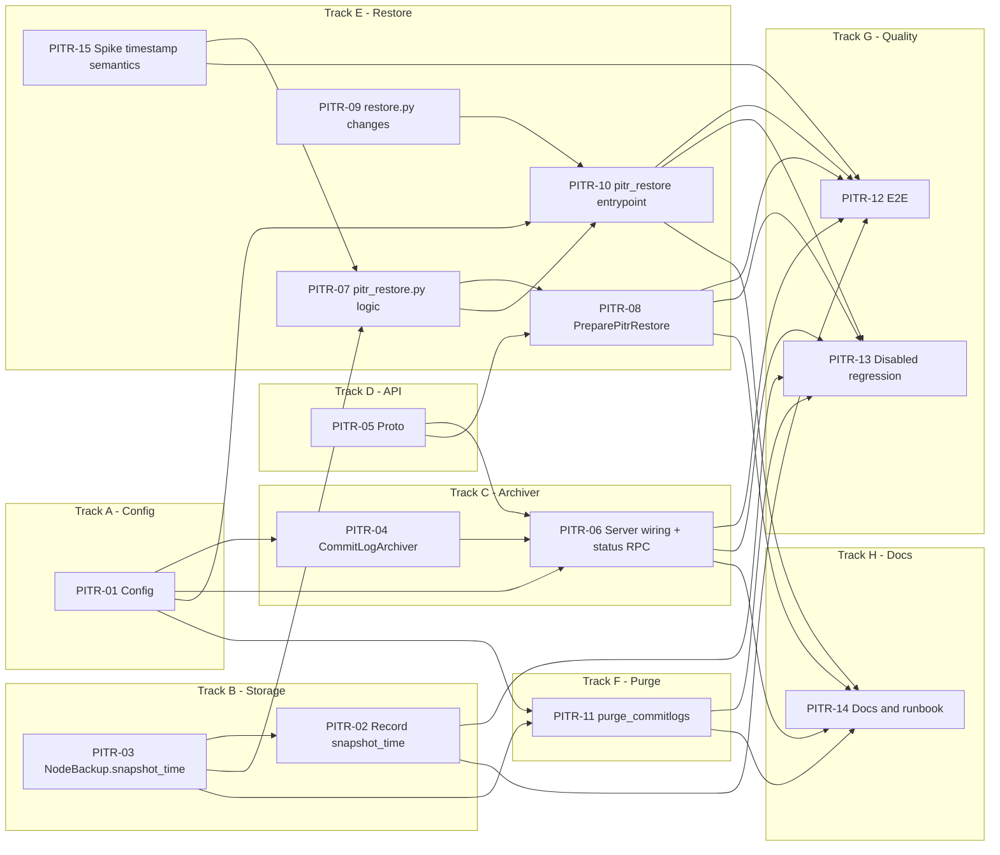

# PITR Ticket Index

Source: [`pitr-design-doc.md`](../../superpowers/specs/pitr-design-doc.md)

No production readiness spec found. Tickets use design doc sections only.
No L work units. No Epics needed.

## Sizing table

| ID | Title | Size | Ideal Days | Track | Dependencies | File |
|---|---|---|---|---|---|---|
| PITR-01 | Add `[pitr]` config section | XS | 1 | A - Config | None | [PITR-01](PITR-01-pitr-config.md) |
| PITR-02 | Record `snapshot_time` at backup time | S | 3 | B - Storage | PITR-03 (merge first or same release) | [PITR-02](PITR-02-record-snapshot-time.md) |
| PITR-03 | Expose `snapshot_time` on `NodeBackup` / `ClusterBackup` | S | 3 | B - Storage | None (shares blob contract with PITR-02) | [PITR-03](PITR-03-node-backup-snapshot-time.md) |
| PITR-04 | Implement `CommitLogArchiver` thread | S | 4 | C - Archiver | PITR-01 | [PITR-04](PITR-04-commitlog-archiver.md) |
| PITR-05 | Add PITR RPCs to `medusa.proto` and regenerate stubs | XS | 1 | D - API | None | [PITR-05](PITR-05-proto-changes.md) |
| PITR-06 | Wire archiver into gRPC server + `GetCommitLogArchiveStatus` | S | 2 | C - Archiver | PITR-01, PITR-04, PITR-05 | [PITR-06](PITR-06-server-archiver-wiring.md) |
| PITR-07 | Implement `medusa/pitr_restore.py` pure logic | S | 4 | E - Restore | PITR-03, PITR-15 | [PITR-07](PITR-07-pitr-restore-logic.md) |
| PITR-08 | Implement `PreparePitrRestore` RPC | S | 3 | E - Restore | PITR-05, PITR-07 | [PITR-08](PITR-08-prepare-pitr-restore-rpc.md) |
| PITR-09 | Update `restore.py` for per-node `backup_name` + mapping | S | 3 | E - Restore | None | [PITR-09](PITR-09-restore-py-changes.md) |
| PITR-10 | Implement `medusa.service.grpc.pitr_restore` entrypoint + `docker-entrypoint.sh` | S | 4 | E - Restore | PITR-01, PITR-07, PITR-09 | [PITR-10](PITR-10-pitr-restore-entrypoint.md) |
| PITR-11 | Add `purge_commitlogs` to `medusa purge` | S | 2 | F - Purge | PITR-01, PITR-03 | [PITR-11](PITR-11-purge-commitlogs.md) |
| PITR-12 | E2E integration test: PITR restore | S | 5 | G - Quality | PITR-02, PITR-06, PITR-08, PITR-10, PITR-15 | [PITR-12](PITR-12-e2e-pitr-restore.md) |
| PITR-13 | Regression check: PITR disabled = zero behaviour change | XS | 1 | G - Quality | PITR-02, PITR-06, PITR-08, PITR-10, PITR-11 | [PITR-13](PITR-13-disabled-regression.md) |
| PITR-14 | Docs, operator contract notes, runbook, rollout guide | S | 2 | H - Docs | PITR-06, PITR-08, PITR-10, PITR-11 | [PITR-14](PITR-14-docs-runbook.md) |
| PITR-15 | Spike: restore_point_in_time resolution and UTC | XS | 1 | E - Restore | None | [PITR-15](PITR-15-spike-timestamp-semantics.md) |

Total: 39 ideal days. Critical path: PITR-03 -> PITR-07 -> PITR-10 -> PITR-12 (about 16 ideal days).

## Dependency diagram

## Sprint guidance

- Wave 1 (parallel, no blockers): PITR-01, PITR-03, PITR-05, PITR-09, PITR-15.
- Wave 2: PITR-02, PITR-04, PITR-07, PITR-11 (after wave 1 deps).
- Wave 3: PITR-06, PITR-08, PITR-10.
- Wave 4: PITR-12, PITR-13, PITR-14.

## Go/no-go checklist for enabling PITR in production

Taken from design doc section 6.5 (Rollout). Not tickets.

- [ ] Merged with `pitr.enabled = false` default. No behaviour change seen.
- [ ] Enabled in non-production. Archiver uploads confirmed with `GetCommitLogArchiveStatus`.
- [ ] PITR restore tested on a non-production cluster.
- [ ] Open questions 2 and 3 resolved (PITR-15).
- [ ] Purge window large enough to keep all wanted recovery points.
- [ ] Operator side (`k8ssandra-operator`) work done. Tracked in the separate operator design doc. Out of scope here.

## Out of scope

`k8ssandra-operator` changes, cross-topology PITR, DSE, custom `restore_command`, commitlog encryption, new CLI commands. See design doc section 1.
